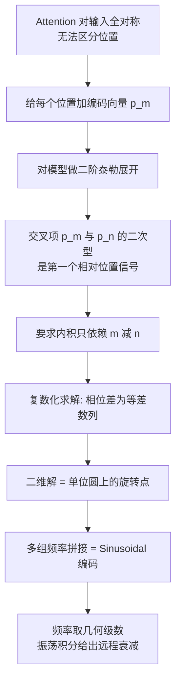

# 01｜Transformer升级之路：1、Sinusoidal位置编码追根溯源

> 原文：苏剑林，《Transformer升级之路：1、Sinusoidal位置编码追根溯源》，2021-03-08
> 链接：https://kexue.fm/archives/8231
> 主线：A. Transformer 升级之路

## Summary

升级之路的开篇不谈新方法，而是回答一个「考古」问题：原始 Transformer 的 Sinusoidal 位置编码为什么长这样？作者的结论是——它不是随手凑的，而是「绝对编码表达相对位置 + 远程衰减」两个约束下几乎必然的解。这篇是下一篇 RoPE 的地基：RoPE 的函数方程正是把这里的要求从「加性编码」搬到「乘性变换」上。

## 大纲

1. 问题设定：无位置编码的 Attention 是全对称的，必须外加位置向量打破对称性
2. 泰勒展开：把加了位置编码的模型展开，第一个同时含两个位置的交叉项是关键
3. 相对位置约束：在交叉项上要求内积只依赖相对距离，反解出编码形式
4. 远程衰减：频率的几何级数选择让内积随距离衰减，源于振荡积分的渐近性质
5. 一般情形：交叉项矩阵近似对角时上述性质近似保留；BERT 嵌入协方差的实测支持这一点

## 推导脉络

## 关键点（自行复述）

- 设模型为 $f$ ，给位置 $m$ 、 $n$ 的输入分别加上编码向量后展开，含双位置的最低阶项形如 $p_m$ 与 $p_n$ 经 Hessian 耦合的二次型；先在 Hessian 为单位阵的理想情形求解。
- 理想情形要求 $\langle p_m, p_n \rangle = g(m-n)$ 。二维时把向量看作复数，内积写成乘积取实部；由模长方程得模长恒定，由相位方程得相位 $\phi_m$ 满足 $\phi_m - \phi_n = \phi_{m-n}$ ，故相位是等差数列，通项为 $m\theta$ 。
- 高维情形由内积的线性叠加性拼接多个二维解，每组用不同频率 $\theta_i$ ，即得 Sinusoidal 形式；剩下的问题只是频率怎么选。
- 取 $\theta_i = 10000^{-2i/d}$ 时，内积可近似为振荡积分 $\int_0^1 e^{i(m-n)\theta_t} dt$ ，由振荡积分的渐近衰减得到「距离越远、相关越弱」。作者指出几乎任何光滑单调的 $\theta_t$ 都有此性质，10000 只是折中，不是唯一解。

## 我的注记

- 这篇的范式值得单独记：**先写下「想要的性质」为方程，再解方程得结构**。RoPE、后面的 MLA 分析、Muon 的最速下降推导都是同一范式的复用。
- 「远程衰减来自振荡积分」这一笔把 NLP 的设计问题接到了量子力学/调和分析的经典工具上，是苏剑林式的跨界手法。
