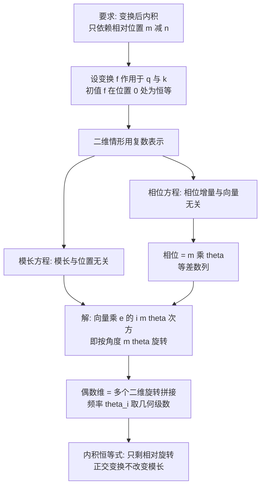

# 02｜Transformer升级之路：2、博采众长的旋转式位置编码

> 原文：苏剑林，《Transformer升级之路：2、博采众长的旋转式位置编码》，2021-03-23
> 链接：https://kexue.fm/archives/8265
> 主线：A. Transformer 升级之路

## Summary

RoPE 的原始出处。出发点是上一篇的遗憾：Sinusoidal 是「想成为相对位置编码的绝对位置编码」，但只做到了近似。作者改换问题——不再给输入加编码向量，而是给每个位置的 $\boldsymbol{q}$ 、 $\boldsymbol{k}$ 施加一个与位置有关的变换，要求变换后的内积只依赖相对位置。解这个函数方程，唯一自然的解就是按位置角度旋转向量：旋转式位置编码（Rotary Position Embedding, RoPE），对应论文 RoFormer（arXiv:2104.09864）。

## 大纲

1. 基本思路：绝对编码的形式、相对编码的效果，两者兼得的提法
2. 求解过程：二维 + 复数，先定模长再定相位
3. 编码形式：分块对角旋转矩阵，及逐元素的高效实现
4. 远程衰减：沿用 Sinusoidal 的频率选择，Abel 变换证明衰减趋势
5. 线性场景：RoPE 是当时唯一能用于线性 Attention 的相对位置编码
6. 模型开源：RoFormer（WoBERT + RoPE）的预训练与长文本实验

## 推导脉络

## 关键公式（骨架）

核心恒等式：位置 $m$ 处的 $\boldsymbol{q}$ 乘旋转矩阵 $\mathcal{R}_m$ 、位置 $n$ 处的 $\boldsymbol{k}$ 乘 $\mathcal{R}_n$ 后，内积满足

$$(\mathcal{R}_m \boldsymbol{q})^{\top} (\mathcal{R}_n \boldsymbol{k}) = \boldsymbol{q}^{\top} \mathcal{R}_{n-m} \boldsymbol{k}$$

- $\mathcal{R}_m$ 是分块对角正交矩阵，每个 $2 \times 2$ 块是角度为 $m\theta_i$ 的旋转，频率取 $\theta_i = 10000^{-2i/d}$ 。
- 实现上不用真做矩阵乘法：把向量两两分组，分别乘 $\cos m\theta_i$ 、 $\sin m\theta_i$ 再交叉加减即可，计算量与一次逐元素运算同级。
- 远程衰减的证明工具是 Abel 变换（分部求和）：把内积写成各频率分量之和后，衰减性归结为部分和 $S_j$ 随相对距离的平均大小。

## 我的注记

- 与 01 的对照是关键：01 是在「加法」框架里近似求解，02 换成「乘法/变换」框架后方程有了干净的精确解。**换表示比硬解方程更重要**，这是这篇最值得带走的方法论。
- RoPE 只动 $\boldsymbol{q}$ 、 $\boldsymbol{k}$ 不动 $\boldsymbol{v}$ ，且不依赖 Attention 矩阵本身，所以能塞进线性 Attention——这个性质在十年后 KDA/NoPE 的讨论里还会回响（见笔记 07）。
- 频率基数（base）的选择在当时是沿用，后来成为长上下文外推的核心旋钮（升级之路 10、18 篇），是 backlog 里优先要补的。
