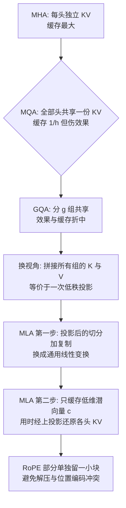

# 03｜缓存与效果的极致平衡：从MHA、MQA、GQA到MLA

> 原文：苏剑林，《缓存与效果的极致平衡：从MHA、MQA、GQA到MLA》，2024-05-13
> 链接：https://kexue.fm/archives/10091
> 主线：B. 注意力变体与 KV Cache

## Summary

DeepSeek-V2 发布后，作者梳理 KV Cache 压缩的完整演化链：MHA → MQA（所有头共享一份 KV）→ GQA（分组共享）→ MLA。核心观点是反直觉的：MLA 的本质**不是**低秩投影——把 GQA 的所有 K、V 拼起来看，GQA 本身就是一次低秩投影；MLA 真正的改动在投影之后：把 GQA 的「切分 + 复制」换成可学习的通用线性变换，并改为只缓存投影后的低维潜向量，用时再解压。

## 大纲

1. MHA 与 KV Cache 的由来：自回归生成时历史 K、V 可缓存复用
2. 瓶颈分析：长上下文下 KV Cache 主导显存与带宽，成为推理成本的决定项
3. MQA：共享到极致，缓存降为 $1/h$ ，效果有损
4. GQA：分组共享， $g = h$ 退化为 MHA、 $g = 1$ 退化为 MQA 的连续过渡
5. MLA 上篇：GQA 的拼接视角揭示其低秩投影本质
6. MLA 下篇：投影后换通用线性变换 + 只缓存潜向量 + 与 RoPE 的兼容处理

## 推导脉络

## 关键点（自行复述）

- KV Cache 的大小按「每 token 每层需存的维度数」计：MHA 是 $h(d_k + d_v)$ 量级，MQA 把它压到 $(d_k + d_v)$ ，GQA 压到 $g(d_k + d_v)$ 。
- Llama2/3-70B 取 $g = 8$ 不是偶然：一机 8 卡时每组 KV 正好落在一张卡上，兼顾多样性与卡间通信。
- MLA 中每个 token 只存一个低维潜向量 $\boldsymbol{c}$ （由输入经下投影得到），各头的 K、V 由 $\boldsymbol{c}$ 经各自的上投影线性生成；缓存的是 $\boldsymbol{c}$ 而非展开后的 KV。
- RoPE 与低秩压缩有冲突（位置旋转不可与投影交换），MLA 的处理是把 K 拆成「无位置的内容部分 + 一小块共享的带 RoPE 部分」拼接——这个「Partial RoPE」结构在笔记 04 里被证明是效果来源之一。

## 我的注记

- 这篇的分析手法是「等价改写」：把看似不同的架构放到同一坐标系（低秩投影 + 后处理）里比较，差异立刻显形。和他把 FFN 改写成专家之和（笔记 05）是同一招。
- 结论对做推理系统的人很实用：选 Attention 先算「每 token 缓存维度」这本账，再谈效果；MLA 在这本账上接近 MQA，效果却接近 MHA，这才是它流行的原因。
