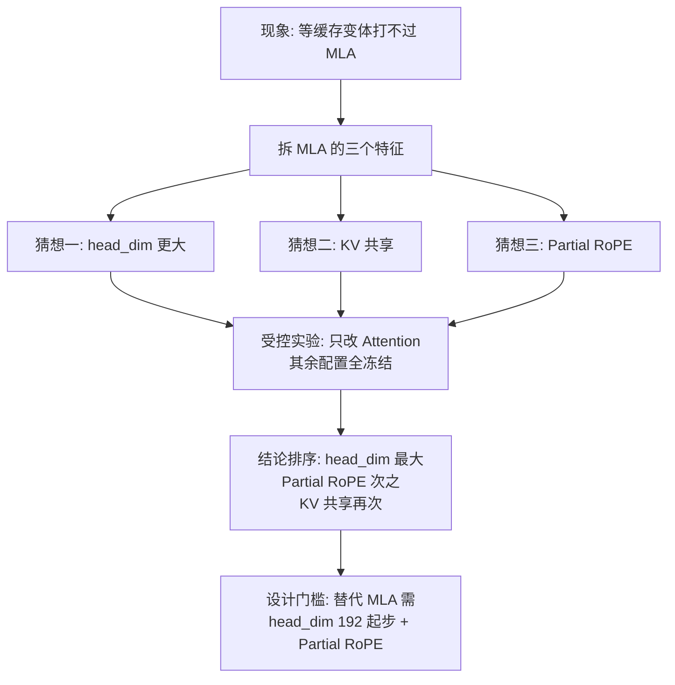

# 04｜Transformer升级之路：20、MLA为什么如此之好？（上）

> 原文：苏剑林，《Transformer升级之路：20、MLA为什么如此之好？（上）》，2025-05-04
> 链接：https://kexue.fm/archives/10907
> 主线：A / B

## Summary

上一篇（笔记 03）讲清了 MLA 的结构，这一篇追问效果：同等甚至更小的 KV Cache 下，许多变体就是打不过 MLA，原因是什么？作者提出三个候选猜想——增大 head_dim、KV 共享（K 与 V 共用维度）、Partial RoPE——然后用一组严格受控的小模型实验逐个验证。结论排序：**增大 head_dim 是最大功臣**，Partial RoPE 次之，KV 共享再次之；同等缓存下「加宽单头」远胜「增加组数」。

## 大纲

1. 观察：先厘清 MLA 的三副面孔（训练时是 qk 维度 128+64 的 MHA；解码时等价于 head_dim 512+64 的 KV 共享 MQA；拼接处即 Partial RoPE）
2. 三个猜想：head_dim、KV-Shared、Partial RoPE
3. 实验设置：Llama 式 Dense 小模型（hidden 2048、12 层、16 头），Muon 优化器，16B token，只改 Attention
4. 第一轮：与等缓存的 GQA 基线对比，初步验证 head_dim 与 Partial RoPE
5. 第二轮：KV 共享的两种构造（S1/S2，后者引入 VO-RoPE），及参数量对齐的三种补测
6. 结论与意义：替代 MLA 的设计门槛——head_dim 至少从 192 起步

## 实验结论（原文数据，自行摘录要点）

- MLA（缓存 576/token/层量级）与 7 倍缓存的 MHA 打平（Loss 同为 2.721 量级）。
- 等缓存对比中 GQA1-256 明显优于 GQA2-128：组数减半、单头翻倍更好。
- 给 GQA1-256 加上 Partial RoPE（256 维拆 192 无位置 + 64 带 RoPE）后 Loss 进一步下降，反超 MLA。
- KV 共享版 GQA2-(192+64)-S2（引入 VO-RoPE）也能小幅反超 MLA，说明 KV-Shared 确有贡献，但量级小于 head_dim。
- 参数对齐补测：双倍头数 vs 双倍 head_dim 差约 0.003；砍 MLP 补参数比砍 head_dim 划算；Q&O 用 LoRA 几乎可以免费换到大 head_dim。

## 推导脉络

## 我的注记

- 这是「博客做受控实验」的范本：参数量不对齐这个最常见的质疑，作者用三种对齐方式（加头数、砍 MLP、Q&O LoRA）正面补测，而不是嘴上声明。
- 对 K3 的选型（笔记 07）这是前置伏笔：既然 head_dim 与 Partial RoPE 是 MLA 的命根子，K3 保留 MLA、只动其余部分就是保守而合理的。
- 一个可迁移的经验法则：**注意力预算优先花在 head_dim 上，其次才是头数/组数**。
