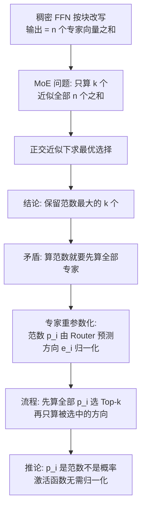

# 05｜MoE环游记：1、从几何意义出发

> 原文：苏剑林，《MoE环游记：1、从几何意义出发》，2025-02-08
> 链接：https://kexue.fm/archives/10699
> 主线：C. MoE 环游记

## Summary

环游记开篇不用「路由器 + 专家」的常规叙事，而是把稠密 FFN 按列分块改写成 $n$ 个「专家向量」之和，于是 MoE 的问题变成一个纯几何问题：从 $n$ 个向量里只挑 $k$ 个求和，怎样最接近全部之和？正交近似下答案是挑范数最大的 $k$ 个；为了让「挑范数」本身不花全额计算，再把每个专家重参数化为「低成本预测的范数 × 归一化方向」，Router 由此获得了明确的几何身份——范数预测器。

## 大纲

1. 问题定义：FFN 按中间维度分块 = 专家向量之和
2. 稀疏化问题：选 $k$ 个近似 $n$ 个，等价于丢弃 $n-k$ 个使丢弃和的范数最小
3. 范数排序：正交假设下最优策略是保留范数最大者；概率采样视角下最优采样概率也正比于范数
4. 困境：要挑范数最大的，必须先把所有专家都算出来——省算目的落空
5. 重参数化：专家 = 范数（Router 廉价预测）× 方向（被选中才计算）
6. 推论：Router 的激活不必归一化，Softmax 不是必选项，Sigmoid/ReLU 可以避免专家间的零和竞争

## 推导脉络

## 关键点（自行复述）

- FFN 写成 $\boldsymbol{y} = f(\boldsymbol{x} \boldsymbol{W}^{(A)}) \boldsymbol{W}^{(B)}$ ，把 $\boldsymbol{W}^{(A)}$ 按列、 $\boldsymbol{W}^{(B)}$ 按行切成 $n$ 块，第 $i$ 块的贡献 $\boldsymbol{v}_i$ 就是一个「专家」；稠密模型即 $\sum_i \boldsymbol{v}_i$ 。
- 选择问题写成 0/1 指示变量上的优化；当各 $\boldsymbol{v}_i$ 两两正交时，丢弃集合的范数平方等于各范数平方之和，于是最优丢弃 = 范数最小的 $n-k$ 个。不正交时仍沿用此近似，几何直觉是：范数大的向量在求和中更难被抵消。
- 最终形式： $\boldsymbol{y} = \sum_{i \in \text{Top-}k(\boldsymbol{p})} p_i \boldsymbol{e}_i$ ，其中 $\boldsymbol{p}$ 是 Router（一个 $d \to n$ 的小线性层加非负激活）的输出。
- 与教科书 MoE 的差别只有一个 Normalize 步骤，但解释力完全不同：稠密模型与 MoE 在此框架下是同一个和式的全量与 Top-k 版本，MoE 是对稠密模型的**有理论依据的近似**，而不是另起炉灶的结构。

## 我的注记

- 「把已有结构改写成和式，再做稀疏近似」与 MLA 的拼接视角（笔记 03）同源。这套几何语言也是整个环游记的坐标系：后面的负载均衡（笔记 06）、动态激活、QB 都在这个框架里展开。
- Router 输出不必归一化这一点，后来在 DeepSeek 的 Sigmoid + bias 路线里得到工业界验证，几何视角算是提前给出了理由。
