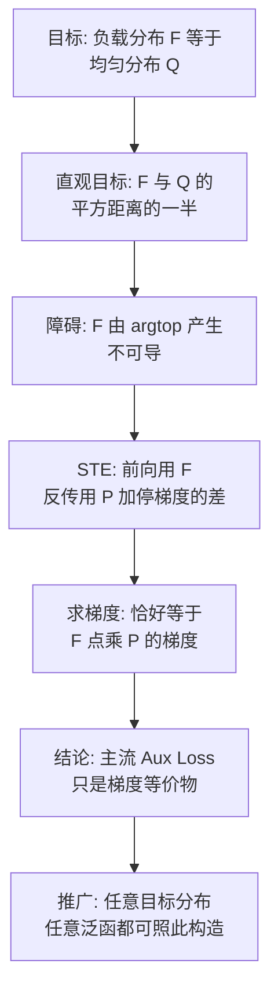

# 06｜MoE环游记：2、不患寡而患不均

> 原文：苏剑林，《MoE环游记：2、不患寡而患不均》，2025-02-21
> 链接：https://kexue.fm/archives/10735
> 主线：C. MoE 环游记

## Summary

主题是负载均衡：专家闲忙不均会同时浪费算力（死专家）和损害效果（Token 被丢弃）。全行业都在用的均衡辅助损失（Aux Loss）几乎从没人给出过推导，作者用直通估计（STE）把它从第一性原理推了出来，并指出一个常被忽略的事实：常用的 Aux Loss 形式只是与「真正的目标」梯度等价，它本身并不是一个越小越好的 loss。文末给出由任意目标分布构造 Aux Loss 的通用配方。

## 大纲

1. 需求分析：实际训练是「先按专家分配算力、再分发 Token」，不均衡 = 死专家 + Token Drop
2. 记号：负载分布 $\boldsymbol{F}$ （由 Top-k 指示平均得到）与平滑近似 $\boldsymbol{P}$ （Router 概率平均）
3. 主流 Aux Loss 的形式： $\mathcal{L}_{aux} = \boldsymbol{F} \cdot \boldsymbol{P}$ ，源头是 GShard
4. STE 推导：从直观目标 $\frac{1}{2} \| \boldsymbol{F} - \boldsymbol{Q} \|^2$ 出发，反传时用 $\boldsymbol{P}$ 替换不可导的 $\boldsymbol{F}$ ，恰好得到主流形式
5. 澄清：该 Aux Loss 只有梯度等价的意义，最小值不在均衡点，不能按普通 loss 理解
6. 通用形式：目标可换成任意分布，构造可换成熵等其他泛函

## 推导脉络

## 关键点（自行复述）

- $\boldsymbol{F}$ 是 Top-k 选择的经验频率（真实负载）， $\boldsymbol{P}$ 是 Router 输出归一化后的期望（可导的平滑版），均衡即 $\boldsymbol{F}$ 趋于均匀分布 $\boldsymbol{Q}$ 。
- STE 的写法是把 $\boldsymbol{F}$ 替换为 $\boldsymbol{P} + \text{sg}[\boldsymbol{F} - \boldsymbol{P}]$ ：前向数值不变，反传梯度只走 $\boldsymbol{P}$ 。展开求导后，常数项因 $\sum_i P_i = 1$ 而消失，最终梯度与 $\sum_i F_i P_i$ 的梯度完全一致——这就是主流 Aux Loss 的来历。
- 反例澄清：取 $\boldsymbol{F} \neq \boldsymbol{P}$ 时 $\sum_i F_i P_i$ 可以小于其在 $\boldsymbol{F} = \boldsymbol{P}$ 处的值 $1/n$ ，所以把它当「越小越好」的 loss 是误解；它只是借了个壳的梯度载体。
- 配方推广：先对 $\boldsymbol{F}$ 写任何你想要的目标（如负熵最大化），再做同样的 STE 替换即得可实现的 Aux Loss； $\boldsymbol{P}$ 也不必非归一化不可。

## 我的注记

- 这篇是理解后来 Loss-Free 路线（用 bias 调节而非加损失）和 K3 的 QB（笔记 07）的必读前置：先知道 Aux Loss 的本质是「梯度手术」，才能看懂为什么大家想绕开它（它毕竟会污染主损失的梯度景观）。
- 方法论同款：**对流行配方先问「它到底在优化什么」**，推不出来就自己从目标反推——环游记 6 的 QB 正是沿这条路走出的新方案。
