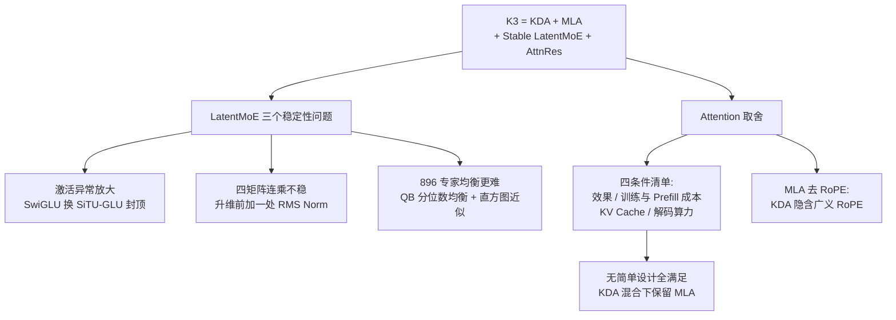

# 07｜简单谈谈K3的MoE和Attention

> 原文：苏剑林，《简单谈谈K3的MoE和Attention》，2026-08-04
> 链接：https://kexue.fm/archives/11848
> 主线：G. Kimi 工程报告解读

## Summary

Kimi K3（总参数 2.8T、896 个专家激活 16 个、原生 100 万上下文）的架构复盘。作者的总判断：K3 不是推倒重来，而是 K2 路线的集大成——架构 = KDA + MLA + Stable LatentMoE + AttnRes，优化器仍是 Moonlight 版 Muon（Attention 部分改 Per-Head）。本文重点讲两块：LatentMoE 如何被「驯服」到稳定（SiTU-GLU + 一处关键的 RMS Norm），以及在 MTP 时代重新审视后为什么仍选 MLA；外加一个彩蛋：K3 的 MLA 去掉了 RoPE（NoPE），因为 KDA 本身隐含广义 RoPE 效应。

## 大纲

1. 总览：K3 的四个组件与各自出处（AttnRes、KDA 另有专文/技术报告）
2. MoE 之一 SiTU：SwiGLU 的异常激活可达输入范数的四次方量级，用 softcap 版的 SiTU-GLU 双侧封顶
3. MoE 之二 Norm：LatentMoE 是四个矩阵连乘、天然不稳；消融发现只需在升维前加一处 RMS Norm（Stable LatentMoE），且它还白赚效果（平衡 Routed/Shared 专家配比、等效加深）
4. MoE 之三 QB：专家数涨到 896 后，K2 的 Loss-Free SignSGD 式 bias 更新不稳，换成基于分位数的 QB（环游记 6）；全局分位数用 1000 个 bin 的直方图近似，通信量极低
5. Attention：MLA 与 MTP 的冲突（解码时等价大 head_dim MQA，已预支算力）；给出「优于 MLA 的注意力」四条件清单，目前无简单设计能全满足，KDA 混合又缓解了 MLA 的短板，故保留
6. DSV4 插曲：DeepSeek V4 看似弃用 MLA，实则是按升级之路 20/21 的方向把 MLA 推向另一极端（大 head_dim MQA + 稀疏 + 压缩）
7. NoPE：KDA 可等价地给 Q、K 提供类 RoPE 的位置效应，故混合架构里的 MLA 可以去掉 RoPE；但全 MLA 的 K2 不行

## 推导脉络

## 关键数字（原文口径）

- MoE 形态：原计划 448 选 8，引入 LatentMoE 后变为 896 选 16，稀疏率不变（先降维到 $d/2$ ，在低维做双倍规模的 MoE，再升维）。
- SiTU 的 softcap 参数：门控侧 $\beta_1 = 4$ ，线性侧 $\beta_2 = 25$ ；同边界下 softcap 优于 GPT-OSS/DSV4 用的 Hard Clip。
- QB 直方图：1000 个 bin 与 10000 个 bin 的均衡收益无异，取 1000；分布可跨机、跨梯度累积相加聚合。
- MLA 在 K3 的形态：训练视角 qk 维度 192 + 128；解码视角等价 head_dim 512+ 的 MQA——这正是它与投机解码（MTP）冲突的根源。

## 我的注记

- 「理想注意力四条件」清单是很好的决策框架：效果、训练/Prefill 成本、KV Cache、解码算力，任何新变体先过这四关。
- NoPE 的论证链条很苏剑林：升级之路 6 证明任何正交矩阵的幂都能构造广义 RoPE → 线性注意力简史证明 DeltaNet 作用于 Q、K 等价于一类广义 RoPE（PaTH 的等价形式）→ KDA 是更一般的 DeltaNet → 混合架构自带位置效应。十年的博客积累在一篇工程复盘里兑现。
- Stable LatentMoE 的「最小改动原则」值得记：两个候选 Norm 位置只保留消融证明最关键的一个。
