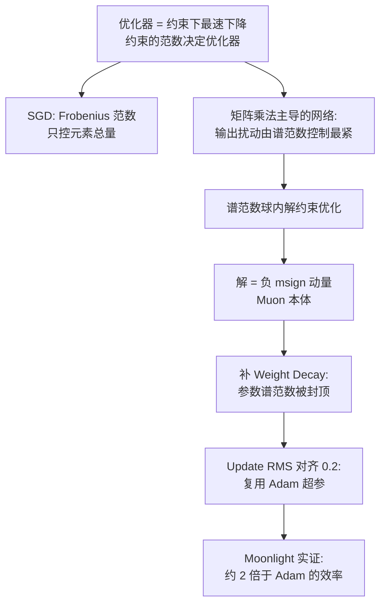

# 08｜Muon续集：为什么我们选择尝试Muon？

> 原文：苏剑林，《Muon续集：为什么我们选择尝试Muon？》，2025-02-27
> 链接：https://kexue.fm/archives/10739
> 主线：D. 优化器与训练科学

## Summary

对 Kimi 技术报告《Muon is Scalable for LLM Training》（开源模型 Moonlight，3B 激活 / 16B 总参 MoE）的解读。回答三个问题：为什么选 Muon、如何从 Adam 快速平移超参、放大后 Muon 与 Adam 的差距如何。核心论证是把优化器统一到一个「最小作用量」框架：优化器之间的本质区别只是**稳定性度量（范数）的选择**；对矩阵参数，最准确的稳定性度量是谱范数，而谱范数约束下的最速下降恰好就是 Muon。

## 大纲

1. 优化原理：理想优化器 = 稳定（每步扰动小）+ 快速（每步降 Loss 多），形式化为约束优化问题
2. 范数之选：SGD 对应 Frobenius 范数约束；由 $\boldsymbol{y} = \boldsymbol{x} \boldsymbol{W}$ 的扰动界，谱范数是控制输出扰动的最紧度量
3. Muon 的导出：谱范数球内最小化线性化 Loss，解为负的矩阵符号函数 $-\text{msign}(\boldsymbol{G})$ ，即对梯度（动量）做 SVD 后把奇异值全换成 1
4. Weight Decay 的必要性：无 WD 时 Muon 前期快、后期被 Adam 追上；补上 WD 后可证明参数谱范数被 $1/\lambda$ 封顶，保住「内部健康」
5. RMS 对齐：观察到 Adam 的 Update RMS 稳定在约 0.2，把 Muon 的更新按解析式 $\sqrt{\max(n, m)}$ 缩放到同一 RMS，即可直接复用 Adam 的学习率与 WD——不同形状的矩阵不该共用同一学习率
6. 实验：2.4B 激活 / 16B MoE 对照，Muon 约 2 倍训练效率；Muon 训出的参数奇异值分布更均匀（奇异值熵更高）

## 推导脉络

## 关键公式（骨架）

谱范数约束下的最速下降：

$$\mathop{\text{argmin}}_{\Delta \boldsymbol{W}} \text{Tr}(\boldsymbol{G}^{\top} \Delta \boldsymbol{W}) \quad \text{s.t.} \quad \| \Delta \boldsymbol{W} \|_2 \leq \eta$$

其解为 $\Delta \boldsymbol{W} = -\eta \, \text{msign}(\boldsymbol{G})$ ，其中 $\text{msign}$ 取 SVD 的 $\boldsymbol{U} \boldsymbol{V}^{\top}$ 部分；实际计算用 Newton-Schulz 迭代近似（本篇只点到，细节在 Muon 赏析篇）。

RMS 对齐的解析结果：msign 输出的 RMS 为 $\sqrt{r / (nm)}$ （ $r$ 为秩），满秩近似下等价于给更新乘 $\sqrt{\max(n, m)}$ 再乘目标 RMS 0.2。

## 我的注记

- 「范数即优化器」这个视角把 SGD/Adam/Muon 放进同一张表：Adam 的逐元素缩放可看作对角度量下的最速下降，Muon 是谱度量下的——选优化器就是选你相信哪种「扰动大小」。
- Update RMS 对齐是个极其实用的工程技巧：新优化器落地时先对齐更新量尺度，能省掉大半调参；它也直接引出下一篇的问题——0.2 这个数到底哪来的（笔记 09）。
- WD 的谱范数封顶证明很干净：更新量谱范数为 1 时，参数范数被夹在 $\max(\| \boldsymbol{W}_0 \|_2, 1/\lambda)$ 之内，对 Attention logit 爆炸这类问题是对症的。
