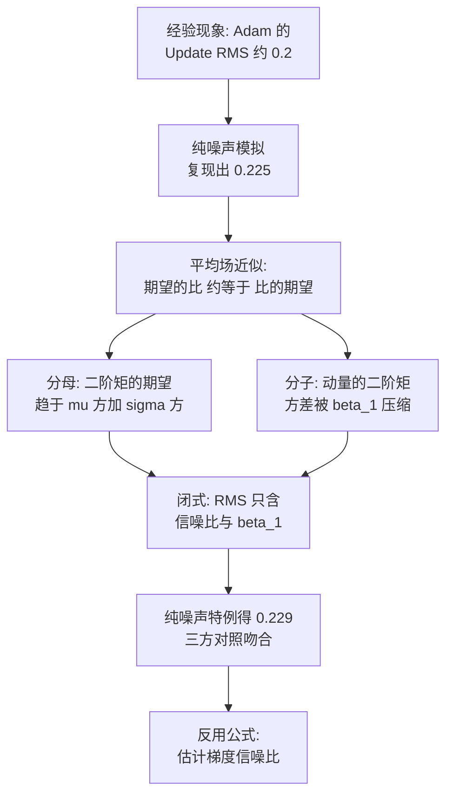

# 09｜为什么Adam的Update RMS是0.2？

> 原文：苏剑林，《为什么Adam的Update RMS是0.2？》，2025-09-02
> 链接：https://kexue.fm/archives/11267
> 主线：D. 优化器与训练科学

## Summary

上一篇（笔记 08）的 RMS 对齐技巧依赖一个经验事实：Adam 训到稳定阶段，更新量的 RMS 几乎总是落在 0.2–0.3。这篇给它一个理论解释：把梯度近似为同分布噪声，用平均场近似（把求期望移到函数内部）算更新量二阶矩，得到只依赖 $\beta_1$ 和梯度信噪比的闭式；在纯噪声极限下 RMS 约为 $\sqrt{(1-\beta_1)/(1+\beta_1)}$ ，代入 $\beta_1 = 0.9$ 得 0.229，与实验和数值模拟（0.225）三方吻合。意外收获：该公式还能反过来估训练中的梯度信噪比。

## 大纲

1. 现象：不同规模模型、同一组 $(\beta_1, \beta_2) = (0.9, 0.95)$ ，Update RMS 都稳定在 0.2–0.3
2. 化简：稳定阶段忽略偏差修正与 $\epsilon$ ，更新量即 $\boldsymbol{u}_t = \boldsymbol{m}_t / \sqrt{\boldsymbol{v}_t}$
3. 数值模拟：梯度直接采样标准正态（纯噪声），模拟 RMS 约 0.225——单步梯度的信噪比低到可以当噪声
4. 平均场推导：分别算 $\mathbb{E}[\boldsymbol{m}_t^2]$ 与 $\mathbb{E}[\boldsymbol{v}_t]$ 再相除
5. 结果分析：RMS 只依赖信噪比与 $\beta_1$ ，与 $\beta_2$ 无关（与模拟一致）；信噪比升高时平均场误差变大，但真实训练信噪比很少到 1
6. 反向应用：由可测的 Update RMS 反解梯度信噪比，并推广到一切带动量的优化器（用 $\| \boldsymbol{m}_t \| / \| \boldsymbol{g}_t \|$ 代替 Update RMS）

## 推导脉络

## 关键公式（骨架）

平均场结论（ $\boldsymbol{\mu}$ 、 $\boldsymbol{\sigma}$ 为梯度的均值与标准差）：

$$\| \boldsymbol{u}_t \|_{RMS} \approx \sqrt{\frac{\| \boldsymbol{\mu} \|^2 / \| \boldsymbol{\sigma} \|^2 + \frac{1 - \beta_1}{1 + \beta_1}}{\| \boldsymbol{\mu} \|^2 / \| \boldsymbol{\sigma} \|^2 + 1}}$$

- 其中动量方差的压缩因子 $\frac{1-\beta_1}{1+\beta_1}$ 来自几何级数求和：加权平均把噪声方差按 $(1-\beta_1)^2 \sum_i \beta_1^{2(t-i)}$ 缩小。
- 纯噪声（ $\boldsymbol{\mu} = \boldsymbol{0}$ ）时退化为 $\sqrt{(1-\beta_1)/(1+\beta_1)}$ ：动量平均越久（ $\beta_1$ 越大），噪声被压得越狠，更新 RMS 越小； $\beta_1 = 0$ 时退化为逐元素符号更新，RMS 为 1，两端都与直觉和模拟自洽。

## 我的注记

- 方法论是物理式的：先数值模拟确认现象对假设不敏感，再平均场硬算，最后三方对照（实验/模拟/公式）。作者自陈平均场的合理性「算出来对得上，过程就八九不离十」——实用主义的理论观。
- 这篇是「重新思考学习率与 Batch Size」系列（平均场是其二的主题）的支线成果，backlog 里应把这组 4 篇 + 本篇作为一组连读。
- 反解信噪比的推广式对做训练监控有用： $\| \boldsymbol{m}_t \| / \| \boldsymbol{g}_t \|$ 是任何带动量优化器都能白算的量。
