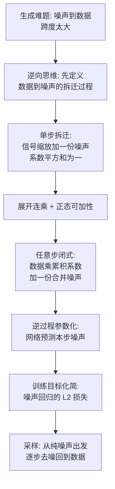

# 10｜生成扩散模型漫谈（一）：DDPM = 拆迁 + 建房

> 原文：苏剑林，《生成扩散模型漫谈（一）：DDPM = 拆迁 + 建房》，2022-06-13
> 链接：https://kexue.fm/archives/9119
> 主线：E. 生成模型

## Summary

扩散漫谈 31 篇的开篇。作者先划清界限：DDPM 与基于能量模型/Score Matching/Langevin 采样的传统扩散模型几乎无关，本质是「渐变模型」——更像 VAE。然后用「拆迁 + 建房」的类比给出全篇最平易的推导：先设计一个逐步加噪把数据拆成纯噪声的前向过程（拆迁），其任意步都有闭式；再把逆过程参数化为「预测本步所加的噪声」，训练目标随之化简为一个普通的噪声回归损失。

## 大纲

1. 新起点：DDPM 的数学框架 2015 年已备齐，2020 年才被调通到高分辨率图像；与传统扩散模型的切割
2. 类比：生成 = 用砖瓦（噪声）建房（数据）；不会建房，先学拆迁——逆着拆迁的每一步就是建房的一步
3. 怎么拆：单步 $\boldsymbol{x}_t = \alpha_t \boldsymbol{x}_{t-1} + \beta_t \boldsymbol{\varepsilon}_t$ 且 $\alpha_t^2 + \beta_t^2 = 1$
4. 一步到位：独立正态的可加性 + 系数平方和恒为 1，得到任意 $t$ 的闭式表达，只需一个合并噪声
5. 怎么建：逆过程写成由噪声预测网络 $\boldsymbol{\epsilon}_{\theta}(\boldsymbol{x}_t, t)$ 参数化的形式，代入 L2 目标后权重因子可略，目标化为预测噪声
6. 降方差：原始损失含四个随机变量（样本、两份噪声、步数 $t$ ），后续段落讨论如何合并随机源以降方差——这也是全系列「把采样方差算清楚」的风格起点

## 推导脉络

## 关键公式（骨架）

前向单步与任意步（记号为本篇自有约定，与 DDPM 原论文不同）：

$$\boldsymbol{x}_t = \alpha_t \boldsymbol{x}_{t-1} + \beta_t \boldsymbol{\varepsilon}_t, \qquad \alpha_t^2 + \beta_t^2 = 1$$

$$\boldsymbol{x}_t = \bar{\alpha}_t \boldsymbol{x}_0 + \bar{\beta}_t \bar{\boldsymbol{\varepsilon}}_t, \qquad \bar{\alpha}_t = \prod_{s=1}^{t} \alpha_s, \quad \bar{\beta}_t = \sqrt{1 - \bar{\alpha}_t^2}$$

- 约束 $\alpha_t^2 + \beta_t^2 = 1$ 的作用是保方差：展开后所有系数平方和恒为 1，合并噪声仍是标准正态。
- 调度选得让 $\bar{\alpha}_T \approx 0$ ，即 $T$ 步后数据成分可忽略、只剩纯噪声，逆过程的起点分布因此已知。
- 逆过程由 $\boldsymbol{x}_{t-1} = \frac{1}{\alpha_t} (\boldsymbol{x}_t - \beta_t \boldsymbol{\varepsilon}_t)$ 反解启发：把真实噪声换成网络预测，L2 误差正比于噪声预测误差，比例因子在实践中直接丢掉。

## 我的注记

- 「拆迁 + 建房」不只是比喻，它精确对应前向/逆向过程的可学性不对称：前向过程可以人为设计到有闭式，学习只发生在逆向——这是所有扩散类方法的结构红利。
- 本系列后续 30 篇的主线是把同一框架推向 ODE/SDE 统一、采样加速与流匹配；连读时建议盯住一个问题：每篇都在改「拆迁方式」「建房步法」「预测对象（噪声/数据/速度）」三者中的哪一个。2025 年的第 31 篇《预测数据而非噪声》正是对本篇「预测噪声」的回响。
